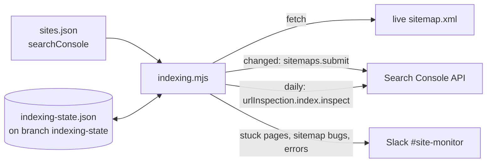

# Site monitor

Watches every LaunchEngine-managed website from one place, and gives every
site repo the same pull request check. Add a site here once; nothing to copy
into the site itself except a five-line workflow.

## What runs

**Monitor** (`.github/workflows/monitor.yml`), scheduled hourly (GitHub
delays busy schedules, so expect every few hours) and on every push
to main. For each site in `sites.json`:

- key pages answer with the expected status, and are not a Netlify edge
  function crash page
- redirects (www to bare domain, old paths) still hold
- the TLS certificate has more than 14 days left
- the published Netlify deploy is in state `ready`
- the live deploy's commit is the head of the repo branch, when `repo` is set
  and `GH_READ_TOKEN` can read it

Read-only. Failures go to Slack, or to GitHub's failure email when the Slack
secret is not set. One run covers every site, so the cost does not grow with
the number of sites.

**Forms** (`.github/workflows/forms.yml`, `forms.mjs`): every form on the sites in `forms.json` reaches its email, workspace and monday, with a daily test and a nightly count. See `FORMS.md`.

**Indexing** (`.github/workflows/indexing.yml`, `indexing.mjs`), every 6 hours,
for sites with a `searchConsole` block in `sites.json`. Search Console's
"Request indexing" button has no API (the Indexing API only covers job posting
and livestream pages, so it is not used). Instead:

- fetches the live sitemap (sitemap index files too) and, when its URLs or
  lastmods changed, resubmits it to Search Console (`submit: true` only)
- reads Search Console's report on that sitemap and flags errors
- once a day, opens every sitemap URL (a redirect or 404 is a sitemap bug)
  and asks the URL Inspection API whether Google indexed it. Pages in the
  sitemap 7+ days and still not indexed are reported in plain words with an
  Inspect link, so a stuck page is one click from "Request indexing"
- one Slack message per run, and the same page is not reported again for
  7 days (site-level problems: 1 day)



State (sitemap hash, each URL's first-seen date, last inspection, what was
already reported) is `indexing-state.json` on the `indexing-state` branch,
which the workflow force-pushes as a single commit after each run. It's free,
survives indefinitely (an Actions cache is evicted after 7 days unused, which
would reset first-seen dates), keeps main's history clean, and a push made
with `GITHUB_TOKEN` triggers no workflows. Delete the branch to start over.
On a site's first run, a lastmod older than today stands in for first seen.

Sites whose sitemap lastmod is the build time (launchengine.com) get
resubmitted after every deploy. That is harmless: Google just rereads it.

Daily inspection uses one call per URL against a quota of 2,000 per property
per day; runs inspect at most 500 per site, least recently inspected first.

### Adding a site to the indexing watch

1. In Search Console for the site's property, add
   `claude-ga-reader@launchengine-dashboard.iam.gserviceaccount.com` as a
   user. **Full** lets it resubmit the sitemap; **Restricted** is enough to
   watch (inspection and the sitemap report both work restricted, checked on
   docrunner.io).
2. Add to the site's entry in `sites.json`:

   ```json
   "searchConsole": { "property": "sc-domain:example.com", "submit": true }
   ```

   `property` is exactly as Search Console names it (`sc-domain:` for a domain
   property, or the URL prefix such as `https://www.example.com/`). Use
   `"submit": false` for watch only. Add `"sitemap": "https://..."` when the
   sitemap isn't at `/sitemap.xml`.

Sites without `searchConsole` are skipped.

**Site check** (`.github/workflows/site-check.yml`), called from each site
repo on pull requests. Builds the site, serves it, and opens every page from
`sitemap.xml` in Chromium at phone (375px) and desktop (1440px) width. Fails
when a page does not load or is wider than a phone screen. Script errors are
printed but do not fail the check, because third-party embeds throw.

## Adding a site

1. Add an entry to `sites.json`. Only `name`, `url` and `pages` are required.
   Add `repo` and `branch` to get the "did the merge actually deploy" check.
   Add `netlify` (site ID) only when the site's host does not match its
   Netlify custom domain.
2. Drop this file into the site repo as `.github/workflows/site-check.yml`:

   ```yaml
   name: Site check
   on: [pull_request]
   jobs:
     check:
       uses: Launch-Engine/site-monitor/.github/workflows/site-check.yml@main
   ```

   A Next.js site passes its build and serve commands:

   ```yaml
       with:
         build: npm ci && npm run build
         serve: npm start -- -p 4173
   ```

3. Protect `main` in the site repo so the `pages` check must pass before
   merging. The reusable workflow can only be called from repos in the
   Launch-Engine org; sites in other orgs (Supra, Elite Realty, Dream Team)
   get the hourly monitor but not the PR check.

## Secrets (set on this repo)

This repo is public, and org secrets marked "private repositories" are not
passed to public repos. Set secrets on this repo (`gh secret set NAME -R
Launch-Engine/site-monitor`), or give the org secret "all repositories" or
selected-repo access that includes this one.

| Secret | Purpose | Required |
|---|---|---|
| `NETLIFY_AUTH_TOKEN` | reads published deploy state across both Netlify teams | yes in CI: the run fails without it, so deploy checks can't quietly stop |
| `SLACK_ALERT_WEBHOOK_URL` | where failures are posted | no, email fallback |
| `GH_READ_TOKEN` | fine-grained token with read access to the site repos, for the drift check | no, drift check skipped |
| `GSC_SERVICE_ACCOUNT_JSON` | the whole JSON key file of the Search Console service account (`claude-ga-reader@...`), pasted as is. Scope requested: `webmasters` | no, the indexing job warns and passes |

## Running by hand

```
node check.mjs                 # every site
node check.mjs danberry        # one site
NETLIFY_AUTH_TOKEN=... node check.mjs
```

Indexing, by hand (needs the key file; `--dry-run` submits nothing, posts
nothing and leaves the state file alone, printing the Slack message instead):

```
GSC_SERVICE_ACCOUNT_FILE=~/ga-access/ga-service-account.json node indexing.mjs --dry-run --inspect
```

Trigger the monitor on demand from the Actions tab, or:

```
gh workflow run monitor.yml -R Launch-Engine/site-monitor
```

## Related

The LaunchEngine Workspace app has its own deeper check in
`Launch-Engine/le-workspace/.github/workflows/deploy-check.yml` (API health,
mail worker heartbeat, sign-in rules). This monitor only confirms its site
URL serves.
